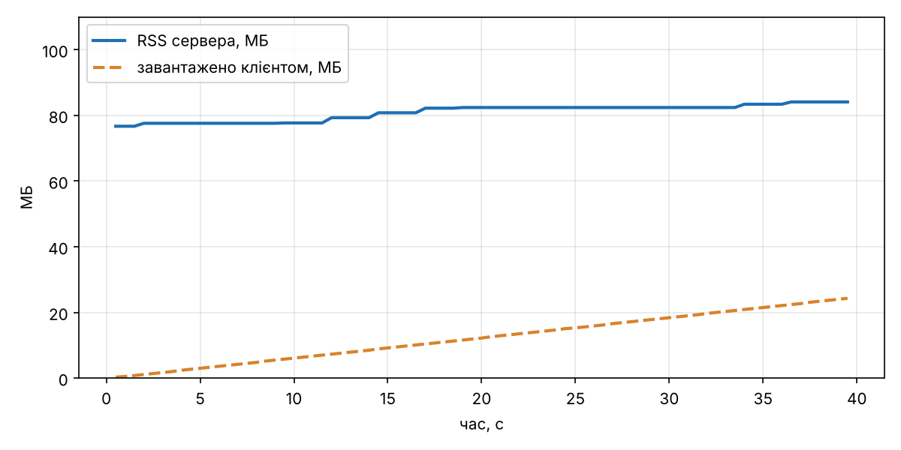

# Dogfight

Мультиплеєрна браузерна гра в реальному часі (курс «Програмування на JavaScript»).
Автор: Попцов Назарій, Б-121-23-2-ПІ.

Запуск: `npm install`, потім `npm run dev` (розробка) або `npm run build && npm run preview`.
Керування: стрілки або WASD, газ – ↑/W.

## Lab 1 – Event loop і ігровий цикл

Структура: `src/loop.js` (rAF + акумулятор), `src/input.js` (замикання), `src/sim/` (фізика без DOM),
`src/render/` (canvas з DPR, інтерполяція, HUD). Тести без браузера: `npm test`.

### Налаштування керування

| Параметр | Значення | Чому |
|---|---|---|
| ROTATE_SPEED | 3,4 рад/с | повний оберт ≈ 1,85 с: можна прицілитись |
| THRUST | 480 px/с² | розгін до максимуму ≈ 0,8 с |
| DRAG | 0,9 1/с | без газу корабель зупиняється за 3–4 с |
| MAX_SPEED | 360 px/с | за один крок 1/60 с – не більше 6 px |

### Експерименти (Chromium 1243, Xvfb 60 Гц, 10 с на кожен)

| Режим | frames/s (HUD) | steps/s | кадр, мс (сер. / σ / max) | кадрів > 33 мс |
|---|---|---|---|---|
| rAF, без змін | 60 | 60 | 16,75 / 1,18 / 33,4 | 1 |
| busy-wait 100 мс кожен 60-й кадр | 55 | 60 | 18,08 / 10,70 / 100,1 | 10 |
| `setInterval(frame, 16)` | 62–63 | 60 | 16,05 / 1,47 / 50,8 | 1 |

1. **Busy-wait.** Раз на секунду гра «завмирає» на 100 мс, потім корабель стрибає: після паузи цикл
   робить 6 кроків поспіль. frames/s падає з 60 до 55, steps/s лишається 60 – акумулятор надолужує.
   Обійти це з того самого потоку неможливо: поки стек зайнятий циклом `while`, event loop не може взяти
   ні rAF, ні подію клавіатури, ні таймер – виконання не переривається (run-to-completion).
2. **setInterval.** Таймер не синхронізований з дисплеєм: 62–63 виклики на секунду при 60 Гц, тобто
   частина кадрів малюється двічі за один refresh або пропускається; розкид більший (σ 1,47 проти 1,18 мс),
   максимум 50,8 мс. Фонову вкладку в цьому середовищі (Xvfb) відтворити не вдалося: сторінка лишалась
   `visible`. У звичайному Chrome rAF у фоні зупиняється, а `setInterval` обмежується до 1 раз/с.
3. **Змінний крок.** Позиція після 5 с утримання газу (старт y = 300):

| Цикл | Без throttling | CPU throttling ×6 |
|---|---|---|
| змінний крок | y = 115,5350 (t = 5,0164) | y = 115,7423 (t = 5,0164) |
| фіксований крок | y = 122,5611 (300 кроків) | y = 122,5611 (300 кроків) |

Зі змінним кроком результат залежить від того, як «нарізано» кадри, і не відтворюється.
З фіксованим – збігається до останнього знака.

## Lab 2 – Об'єкти, класи, this

`src/sim/`: `vector.js` (незмінний `Vector2`), `entity.js` (`Entity` і рівно один рівень
нащадків: `Ship`, `Bullet`, `Asteroid`, `Explosion`, `Pickup`), `world.js` (`World` над `Map`,
`*ofKind`, відкладене видалення), `collision.js` (O(n²) як окрема функція), `behaviors.js`
(компоненти `homing` і ефекти pickup).

### Баг із this (`node scripts/this-bug.js`)

```
1) addEventListener(ship.fire) -> TypeError: Cannot read properties of undefined (reading 'add')
2) () => ship.fire()           -> куля створена
3) ship.fire.bind(ship)        -> куля створена
4) const f = ship.fire; f()    -> TypeError: Cannot read properties of undefined (reading 'dead')
```

Передаючи `ship.fire`, передаємо функцію без об'єкта зліва від крапки. Модулі й класи в strict mode,
тому `this` = `undefined` (або `EventTarget`, якщо викликає DOM). Обрано варіант 2 – стрілку в місці виклику:
вона нічого не коштує екземплярам. `bind` створює нову функцію, і її треба зберегти, щоб потім зняти слухача.
Поле-стрілка `fire = () => {}` у класі працює, але дає копію функції в кожному екземплярі.
У грі `fire()` взагалі не передається в DOM: клавіша лише виставляє `controls.fire`, а `World.step` викликає `s.fire()`.

### Композиція замість ієрархії

Як виглядала б ієрархія: `Entity → Moving → Projectile → Bullet → HomingBullet`,
`Entity → Moving → Rock → Asteroid → HomingAsteroid`, `Entity → Collidable → Pickup → ShieldPickup / RapidPickup`.
Самонаведення довелося б дублювати в двох гілках, а «самонавідна куля від pickup» вимагала б ще один клас.

Обрано компоненти як дані: `e.homing = makeHoming({...})` можна повісити на будь-яку сутність, і
`homingSystem` обробляє все, що має це поле. Pickup – це `Entity` з полем `pickup = { effect, duration }`,
а ефекти – таблиця `PICKUP_EFFECTS` (новий ефект = новий рядок). Дані легко серіалізувати, що знадобиться в Lab 5.

## Lab 3 – Асинхронний JavaScript

`src/assets/loader.js` (`fetchJson`, `loadImage`, `loadAudio`, `withRetry`, `loadAll`), `src/events.js`
(`GameBus extends EventTarget`), `src/audio.js` (Web Audio), `src/ui/lobby.js` (`Lobby extends EventTarget`)
і `src/ui/lobby-view.js` (DOM окремо). Збої імітує `?fault=404|timeout|abort|badjson|slow`, затримку дає
middleware `?delay=мс` у `vite.config.js`.

### Sequential vs concurrent (`node scripts/seq-vs-concurrent.js 200`, 7 файлів, +200 мс на файл)

| Спосіб | Час, мс (3 запуски) |
|---|---|
| послідовні `await` | 1441 / 1427 / 1422 |
| `Promise.all` | 208 / 209 / 208 |

### Головоломки порядку (`node scripts/puzzles.js`, `public/puzzle-raf.html`)

1. `async f(){log A; await 0; log B}; f(); log C` → `A C B`: `await` віддає керування навіть на не-промісі.
2. `setTimeout T1; then{M1; setTimeout T2; queueMicrotask M2}; log S` → `S M1 M2 T1 T2`: мікрозадачі
   доїдаються до кінця, T2 стає в чергу задач після T1.
3. `then(a1, return Promise.resolve()).then(a2)` паралельно з ланцюжком `b1..b4` → `a1 b1 b2 b3 a2 b4`:
   повернений проміс «розгортається» ще за два такти мікрозадач.
4. `new Promise(res => {log exec; res first; res second})` → `exec after first`: виконавець синхронний,
   проміс встановлюється один раз.
5. Усередині задачі: `rAF raf1 {micro-in-raf, setTimeout}`, `rAF raf2`, `then micro`, `log sync` →
   `sync micro raf1 micro-in-raf raf2 timeout-in-raf`: мікрозадачі виконуються після кожного колбека rAF,
   таймер, поставлений у rAF, чекає наступної задачі після рендеру.

### Галерея збоїв

| Збій | Що бачить гравець | Лог |
|---|---|---|
| 404 спрайта | екран з помилкою і Retry | `HttpError: HTTP 404 for assets/missing-ships.png` |
| таймаут мережі (1,5 с) | «таймаут мережі», Retry | `TimeoutError: signal timed out` |
| abort посеред завантаження | «завантаження скасовано», Retry | `AbortError` |
| битий JSON арени | повідомлення, Retry | `SyntaxError: Bad JSON in assets/broken.json` |
| повільний файл (+2,5 с) | прогрес-бар чекає, гра стартує | `loaded in 2599 ms` |

Після Retry гра в усіх чотирьох випадках доходить до лобі.

## Lab 4 – Node.js: EventEmitter, streams, WebSocket

Workspaces `client/` і `server/`. Сервер (`server/src`): `node:http` (статика з MIME і захистом від `..`,
`GET/POST /api/rooms`, `/health`, `/api/replays/:id`), `ws` на `/ws`, `config.js` (змінні оточення з перевіркою),
`rooms.js` (`Room extends EventEmitter`, `RoomManager`), `protocol.js` (ручна перевірка, коди закриття 4000–4008),
`log/matchlog.js` (object-mode `Transform` → NDJSON через `pipeline`), `log/replay.js`. Запуск:
`npm run build && npm start`, розробка – `npm run dev:server` + `npm run dev:client` (Vite проксує `/api` і `/ws`).

### Backpressure: RSS сервера під час повільного завантаження

Синтетичний лог 200 МБ (`server/scripts/make-big-log.js`), клієнт читає ≈ 2 МБ/с (`server/scripts/slow-download.js`), 40 с.



За 40 с клієнт отримав 24,3 МБ; RSS сервера тримався в межах 76,7–84,1 МБ. `pipeline(createReadStream, res)`
припиняє читання файлу, коли `res.write()` повертає `false`, і продовжує після `drain`.

### Цикл подій заблоковано на 300 мс (`server/scripts/block-demo.js`)

Чат кожні 100 мс, о 500 мс – `GET /api/slow` (busy-loop 300 мс): повідомлення, надіслані о 632 і 733 мс,
дійшли за 211 і 110 мс замість 1–3 мс. Поки обробник крутить `while`, libuv не може віддати JS жодної події:
ні WebSocket-кадру, ні таймера, ні іншого HTTP-запиту. Страждають усі кімнати процесу, а не лише цей запит.

### `'error'` без слухача (`server/scripts/error-crash.js`)

Без слухача `emit('error')` кидає виняток, процес завершується з кодом 1 і не встигає надрукувати `tick`.
З `room.on('error', …)` помилка логується, процес працює далі. Тому в `ws.js` кожен сокет має `ws.on('error')`.
Аналог для промісів – unhandled rejection, яка в Node теж завершує процес.
