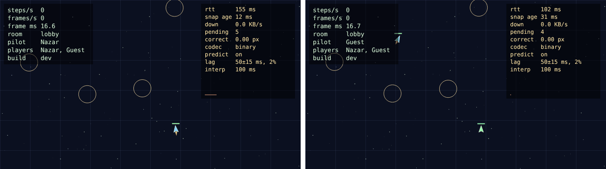
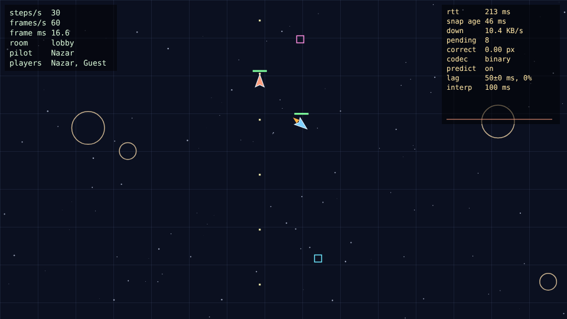
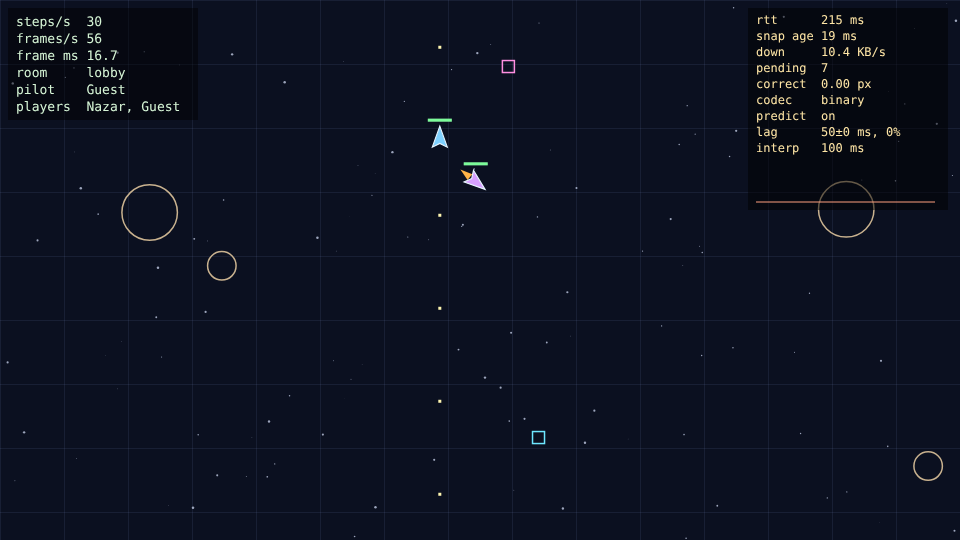
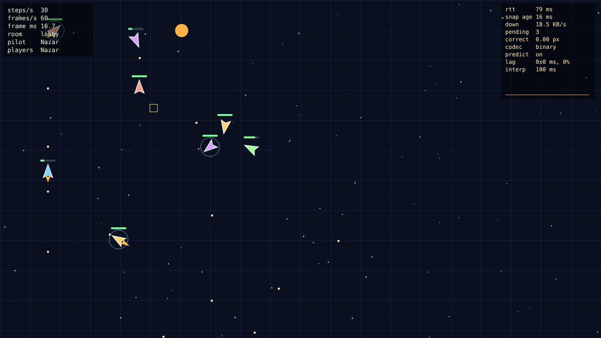
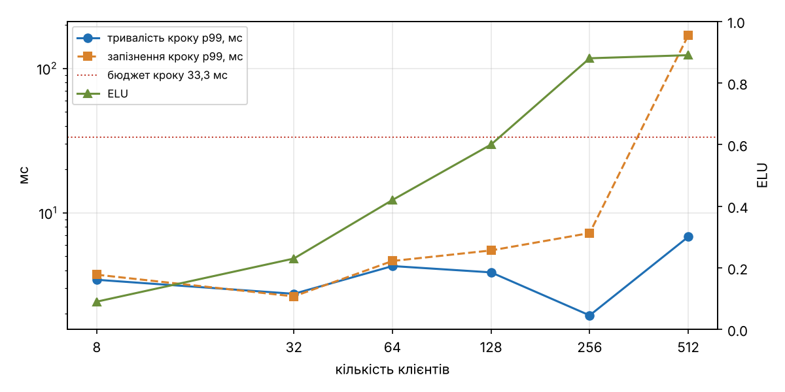
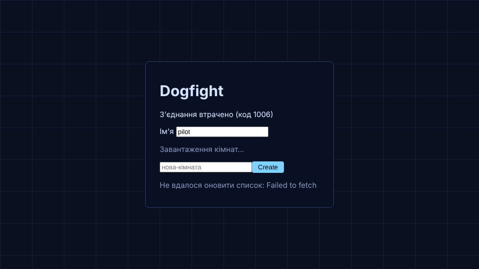

# Dogfight

Мультиплеєрна браузерна гра в реальному часі (курс «Програмування на JavaScript»).
Автор: Попцов Назарій, Б-121-23-2-ПІ.

Запуск: `npm install`, потім `npm run dev` (розробка) або `npm run build && npm run preview`.
Керування: стрілки або WASD, газ – ↑/W.

## Lab 1 – Event loop і ігровий цикл

Структура: `src/loop.js` (rAF + акумулятор), `src/input.js` (замикання), `src/sim/` (фізика без DOM),
`src/render/` (canvas з DPR, інтерполяція, HUD). Тести без браузера: `npm test`.

### Налаштування керування

| Параметр | Значення | Чому |
|---|---|---|
| ROTATE_SPEED | 3,4 рад/с | повний оберт ≈ 1,85 с: можна прицілитись |
| THRUST | 480 px/с² | розгін до максимуму ≈ 0,8 с |
| DRAG | 0,9 1/с | без газу корабель зупиняється за 3–4 с |
| MAX_SPEED | 360 px/с | за один крок 1/60 с – не більше 6 px |

### Експерименти (Chromium 1243, Xvfb 60 Гц, 10 с на кожен)

| Режим | frames/s (HUD) | steps/s | кадр, мс (сер. / σ / max) | кадрів > 33 мс |
|---|---|---|---|---|
| rAF, без змін | 60 | 60 | 16,75 / 1,18 / 33,4 | 1 |
| busy-wait 100 мс кожен 60-й кадр | 55 | 60 | 18,08 / 10,70 / 100,1 | 10 |
| `setInterval(frame, 16)` | 62–63 | 60 | 16,05 / 1,47 / 50,8 | 1 |

1. **Busy-wait.** Раз на секунду гра «завмирає» на 100 мс, потім корабель стрибає: після паузи цикл
   робить 6 кроків поспіль. frames/s падає з 60 до 55, steps/s лишається 60 – акумулятор надолужує.
   Обійти це з того самого потоку неможливо: поки стек зайнятий циклом `while`, event loop не може взяти
   ні rAF, ні подію клавіатури, ні таймер – виконання не переривається (run-to-completion).
2. **setInterval.** Таймер не синхронізований з дисплеєм: 62–63 виклики на секунду при 60 Гц, тобто
   частина кадрів малюється двічі за один refresh або пропускається; розкид більший (σ 1,47 проти 1,18 мс),
   максимум 50,8 мс. Фонову вкладку в цьому середовищі (Xvfb) відтворити не вдалося: сторінка лишалась
   `visible`. У звичайному Chrome rAF у фоні зупиняється, а `setInterval` обмежується до 1 раз/с.
3. **Змінний крок.** Позиція після 5 с утримання газу (старт y = 300):

| Цикл | Без throttling | CPU throttling ×6 |
|---|---|---|
| змінний крок | y = 115,5350 (t = 5,0164) | y = 115,7423 (t = 5,0164) |
| фіксований крок | y = 122,5611 (300 кроків) | y = 122,5611 (300 кроків) |

Зі змінним кроком результат залежить від того, як «нарізано» кадри, і не відтворюється.
З фіксованим – збігається до останнього знака.

## Lab 2 – Об'єкти, класи, this

`src/sim/`: `vector.js` (незмінний `Vector2`), `entity.js` (`Entity` і рівно один рівень
нащадків: `Ship`, `Bullet`, `Asteroid`, `Explosion`, `Pickup`), `world.js` (`World` над `Map`,
`*ofKind`, відкладене видалення), `collision.js` (O(n²) як окрема функція), `behaviors.js`
(компоненти `homing` і ефекти pickup).

### Баг із this (`node scripts/this-bug.js`)

```
1) addEventListener(ship.fire) -> TypeError: Cannot read properties of undefined (reading 'add')
2) () => ship.fire()           -> куля створена
3) ship.fire.bind(ship)        -> куля створена
4) const f = ship.fire; f()    -> TypeError: Cannot read properties of undefined (reading 'dead')
```

Передаючи `ship.fire`, передаємо функцію без об'єкта зліва від крапки. Модулі й класи в strict mode,
тому `this` = `undefined` (або `EventTarget`, якщо викликає DOM). Обрано варіант 2 – стрілку в місці виклику:
вона нічого не коштує екземплярам. `bind` створює нову функцію, і її треба зберегти, щоб потім зняти слухача.
Поле-стрілка `fire = () => {}` у класі працює, але дає копію функції в кожному екземплярі.
У грі `fire()` взагалі не передається в DOM: клавіша лише виставляє `controls.fire`, а `World.step` викликає `s.fire()`.

### Композиція замість ієрархії

Як виглядала б ієрархія: `Entity → Moving → Projectile → Bullet → HomingBullet`,
`Entity → Moving → Rock → Asteroid → HomingAsteroid`, `Entity → Collidable → Pickup → ShieldPickup / RapidPickup`.
Самонаведення довелося б дублювати в двох гілках, а «самонавідна куля від pickup» вимагала б ще один клас.

Обрано компоненти як дані: `e.homing = makeHoming({...})` можна повісити на будь-яку сутність, і
`homingSystem` обробляє все, що має це поле. Pickup – це `Entity` з полем `pickup = { effect, duration }`,
а ефекти – таблиця `PICKUP_EFFECTS` (новий ефект = новий рядок). Дані легко серіалізувати, що знадобиться в Lab 5.

## Lab 3 – Асинхронний JavaScript

`src/assets/loader.js` (`fetchJson`, `loadImage`, `loadAudio`, `withRetry`, `loadAll`), `src/events.js`
(`GameBus extends EventTarget`), `src/audio.js` (Web Audio), `src/ui/lobby.js` (`Lobby extends EventTarget`)
і `src/ui/lobby-view.js` (DOM окремо). Збої імітує `?fault=404|timeout|abort|badjson|slow`, затримку дає
middleware `?delay=мс` у `vite.config.js`.

### Sequential vs concurrent (`node scripts/seq-vs-concurrent.js 200`, 7 файлів, +200 мс на файл)

| Спосіб | Час, мс (3 запуски) |
|---|---|
| послідовні `await` | 1441 / 1427 / 1422 |
| `Promise.all` | 208 / 209 / 208 |

### Головоломки порядку (`node scripts/puzzles.js`, `public/puzzle-raf.html`)

1. `async f(){log A; await 0; log B}; f(); log C` → `A C B`: `await` віддає керування навіть на не-промісі.
2. `setTimeout T1; then{M1; setTimeout T2; queueMicrotask M2}; log S` → `S M1 M2 T1 T2`: мікрозадачі
   доїдаються до кінця, T2 стає в чергу задач після T1.
3. `then(a1, return Promise.resolve()).then(a2)` паралельно з ланцюжком `b1..b4` → `a1 b1 b2 b3 a2 b4`:
   повернений проміс «розгортається» ще за два такти мікрозадач.
4. `new Promise(res => {log exec; res first; res second})` → `exec after first`: виконавець синхронний,
   проміс встановлюється один раз.
5. Усередині задачі: `rAF raf1 {micro-in-raf, setTimeout}`, `rAF raf2`, `then micro`, `log sync` →
   `sync micro raf1 micro-in-raf raf2 timeout-in-raf`: мікрозадачі виконуються після кожного колбека rAF,
   таймер, поставлений у rAF, чекає наступної задачі після рендеру.

### Галерея збоїв

| Збій | Що бачить гравець | Лог |
|---|---|---|
| 404 спрайта | екран з помилкою і Retry | `HttpError: HTTP 404 for assets/missing-ships.png` |
| таймаут мережі (1,5 с) | «таймаут мережі», Retry | `TimeoutError: signal timed out` |
| abort посеред завантаження | «завантаження скасовано», Retry | `AbortError` |
| битий JSON арени | повідомлення, Retry | `SyntaxError: Bad JSON in assets/broken.json` |
| повільний файл (+2,5 с) | прогрес-бар чекає, гра стартує | `loaded in 2599 ms` |

Після Retry гра в усіх чотирьох випадках доходить до лобі.

## Lab 4 – Node.js: EventEmitter, streams, WebSocket

Workspaces `client/` і `server/`. Сервер (`server/src`): `node:http` (статика з MIME і захистом від `..`,
`GET/POST /api/rooms`, `/health`, `/api/replays/:id`), `ws` на `/ws`, `config.js` (змінні оточення з перевіркою),
`rooms.js` (`Room extends EventEmitter`, `RoomManager`), `protocol.js` (ручна перевірка, коди закриття 4000–4008),
`log/matchlog.js` (object-mode `Transform` → NDJSON через `pipeline`), `log/replay.js`. Запуск:
`npm run build && npm start`, розробка – `npm run dev:server` + `npm run dev:client` (Vite проксує `/api` і `/ws`).

### Backpressure: RSS сервера під час повільного завантаження

Синтетичний лог 200 МБ (`server/scripts/make-big-log.js`), клієнт читає ≈ 2 МБ/с (`server/scripts/slow-download.js`), 40 с.


За 40 с клієнт отримав 24,3 МБ; RSS сервера тримався в межах 76,7–84,1 МБ. `pipeline(createReadStream, res)`
припиняє читання файлу, коли `res.write()` повертає `false`, і продовжує після `drain`.

### Цикл подій заблоковано на 300 мс (`server/scripts/block-demo.js`)

Чат кожні 100 мс, о 500 мс – `GET /api/slow` (busy-loop 300 мс): повідомлення, надіслані о 632 і 733 мс,
дійшли за 211 і 110 мс замість 1–3 мс. Поки обробник крутить `while`, libuv не може віддати JS жодної події:
ні WebSocket-кадру, ні таймера, ні іншого HTTP-запиту. Страждають усі кімнати процесу, а не лише цей запит.

### `'error'` без слухача (`server/scripts/error-crash.js`)

Без слухача `emit('error')` кидає виняток, процес завершується з кодом 1 і не встигає надрукувати `tick`.
З `room.on('error', …)` помилка логується, процес працює далі. Тому в `ws.js` кожен сокет має `ws.on('error')`.
Аналог для промісів – unhandled rejection, яка в Node теж завершує процес.

## Lab 5 – Сервер рахує гру

`shared/` – спільний пакет: `sim/` (детермінована симуляція, `rng.js` з seed), `protocol/codec.js`
(бінарний формат і JSON з одним інтерфейсом), `net/reconcile.js` (передбачення і звірка як чисті функції),
`net/interpolation.js` (буфер знімків). Сервер: `server/src/match.js` (30 кроків/с), `server/src/timer.js`
(тікер за абсолютним цільовим часом). Клієнт: `client/src/net/netgame.js`, `lagsim.js`, netgraph праворуч угорі.
Параметри: `?lat=50&jit=15&drop=0.02&predict=0&codec=json&interp=100`.



 

### Формат (little-endian)

Input, 7 байтів: `u8 version | u8 type=1 | u32 seq | u8 buttons`.
Snapshot, 12 + 25·N: `u8 version | u8 type=2 | u32 tick | u32 ackSeq | u16 count`, далі на сутність
`u32 id | u8 kind | f32 x | f32 y | f32 vx | f32 vy | i16 angle | u8 hp | u8 flags`.
Кут: `round(angle/π·32767)`, крок 9,6·10⁻⁵ рад – менше за піксель на відстані 10 000 px.

### JSON vs бінарний (`node shared/scripts/codec-bench.js`, 4 гравці, 30 сутностей, 30 Гц)

| Кодек | Байтів/знімок | КБ/с вниз | Байтів/input | КБ/с вгору | encode+decode, мкс |
|---|---|---|---|---|---|
| JSON | 4294 | 125,8 | 86 | 2,52 | 78,4 |
| Бінарний (DataView) | 762 | 22,3 | 7 | 0,21 | 6,9 |

### Мережа (два вікна Chromium, 6 с, гравець A газує і повертає, B стріляє)

| Режим | RTT A, мс | Поправка A: сер. / max, px |
|---|---|---|
| без штучної затримки | 99 | 0,0001 / 0,0002 |
| 50 мс в кожен бік, без передбачення | 244 | – (корабель рухається лише зі знімком) |
| 50 мс, передбачення | 224 | 0,0001 / 0,0014 |
| 50 ± 15 мс, 2 % втрат | 182 | 0,53 / 90,3 |
| 50 мс, `Math.random()` в integrate на сервері | 161 | 1,09 / 2,34 |

RTT тут – від відправки input до знімка, що його підтверджує, тож він включає й чергу input на сервері
(≈ 3 кроки по 33 мс). Без передбачення затримку відчутно одразу: корабель відповідає на клавішу через RTT.
З передбаченням поправки в межах похибки float32. Великі поправки з'являються лише при втраті пакетів
(сервер повторює попередній input, клієнт – ні) і після навмисного шуму: сервер рахує інакше, ніж клієнт,
і кожен знімок тягне корабель на 1–2 px. Шум прибрано (`SIM_NOISE=0`, за замовчуванням).

### Записка про мережу

- **Затримка:** власний корабель передбачається, чужі сутності малюються на 100 мс у минулому між двома знімками.
  100 мс – це три інтервали знімків, тому один втрачений знімок не дає «стрибка».
- **Розбіжність стану:** симуляція детермінована (seed від сервера, фіксований крок, без `Date.now()`),
  клієнт після кожного знімка ставить корабель у стан сервера і переграє непідтверджені input.
- **Чіти:** координати від клієнта не приймаються; input – лише 4 біти кнопок, `seq` має зростати,
  черга обмежена 8 input, частоту обмежує token bucket.

## Lab 6 – TypeScript

Усі три пакети – TypeScript під `strict` + `noUncheckedIndexedAccess` + `verbatimModuleSyntax`
(`tsconfig.base.json`). Node 22 запускає `.ts` напряму (type stripping), Vite збирає клієнт,
`npm run typecheck` = `tsc --noEmit` у кожному пакеті, стоїть у CI (`.github/workflows/ci.yml`).
`any` – жодного (правило ESLint `no-explicit-any`), приведень `as` – чотири, кожне з коментарем:
три конструктори branded-типів у `shared/src/types.ts` і одне в `loadAll`.
Тест детермінізму (`shared/test`) проходить, поведінка гри не змінилась.

`shared/src/protocol/messages.ts` – zod-схеми всіх JSON-повідомлень, типи виведені з них,
`parseClientMessage(data: unknown)` повертає `Result` і не кидає винятків. Ручний валідатор з Lab 4 видалено.
Бінарний декодер перевіряє довжину, версію, тип, діапазони (`CodecError`). Конфіг сервера – zod-схема.

### Що знайшов TypeScript

1. `owner: 0` у тестах куль – такого id не існує; тип `EntityId | -1` змусив явно писати «нічия» (`-1`).
2. `Omit<ServerMessage, 'v'>` над union «склеїв» варіанти, і `out({ type: 'roster', players })` перестало
   компілюватись – знадобився дистрибутивний `Omit`.
3. `rock.size - 1` давало `number`, а розмір астероїда – `1 | 2 | 3`; тепер розмір дитини рахується явно.
4. `PICKUP_EFFECTS[effect]?.()` – опціональний виклик ховав би новий ефект без обробника; `Record<PickupEffect, …>`
   робить пропуск помилкою компіляції.
5. `new Promise(res => …)` у головоломці мав тип `Promise<unknown>`; `noUncheckedIndexedAccess` знайшов
   десяток місць, де `arr[i]` міг бути `undefined` (кольори кораблів, перший знімок у буфері).

### Три типи простими словами

- **`EntityId = number & { [brand]: 'EntityId' }`** – у рантаймі звичайне число, але компілятор не дасть
  передати номер кроку чи seq туди, де чекають id сутності.
- **`Entity = Ship | Bullet | Asteroid | Explosion | Pickup`** – об'єднання з полем `kind`. Після
  `switch (e.kind)` у кожній гілці TS знає конкретний клас, а `default: assertNever(e)` перестає компілюватись,
  щойно з'являється новий вид без обробника.
- **`Bus<E>` з `emit<K extends keyof E>(type: K, detail: E[K])`** – назва події визначає тип даних:
  `bus.emit('hit', { target, by })` перевіряє саме поля події `hit`.

Фреймворк для лобі/HUD не взято: лобі – це 40 рядків DOM-коду поверх типізованої шини, а Svelte/React
додали б збірку компонентів і бандл без помітного виграшу на такому обсязі.

## Lab 7 – V8, пам'ять і тести

[](https://github.com/Nazariy-Dev/dogfight/actions/workflows/ci.yml)

`npm test` (Vitest, три проєкти) – 101 тест, з них 8 властивостей fast-check (`shared/test/properties.test.ts`):
round-trip кодека, довжина кадру, довільні байти → лише `CodecError`, зіпсований байт, корабель і весь світ
лишаються в арені, `parseClientMessage` приймає валідні й відхиляє зіпсовані. Покриття `shared/`:
94,6 % операторів, 89,5 % гілок (`npm run coverage`). Фейкові таймери – цикл гри, ticker, lagsim.
`npm run e2e` (Playwright): два контексти в одній кімнаті, рух гравця A видно в B за 263 мс, чат доходить.

### Сервер: профіль 60 с гри, 128 ботів, 60 астероїдів (`node --cpu-prof server/bench/profile-tick.ts`)

| Функція | До, мс self | Після, мс self |
|---|---|---|
| `World.ofKind` (генератор по всіх сутностях) | 2110 | – (індекс за видом) |
| `step` | 1854 | 983 |
| колізії (O(n²) / сітка) | 1507 | 1055 + 550 |
| збирач сміття | 930 | 579 |
| усього | 11 626 | 6 268 |

Головною гарячою точкою виявились не колізії, а `ofKind`, який боти викликали для кожного корабля і
кожного астероїда. Після індексу `Map<kind, Set>` загальний час упав на 46 %. Колізії замінено сіткою
з 3×3 сусідами (`shared/src/sim/spatial.ts`); тест перевіряє, що вона дає той самий світ, що й O(n²).
Частинки вибухів беруться з пулу (`Pool`), тест показує ≤ 24 створені об'єкти на 50 вибухів.

### Клієнт: 30 с, 8 ботів, газ і стрільба (Chromium, 60 Гц)

Кадр p50/p95/p99 = 16,7 / 16,8 / 16,8 мс, максимум 33,4 мс (37 кадрів із 1803 довші за 16,8 мс). Збирач
сміття – 54 мс за 30 с (0,2 %), головний потік 46 % часу простоює. Ціль p99 < 16,7 мс досягнута в межах
точності таймера. 

### Web Worker: декодування знімка

Головний потік декодує знімок за 4–8 мкс; передача в воркер і назад коштує головному потоку 46–61 мкс.
Воркер програє – у грі не використовується (`client/public/bench/worker-decode.html`).

### Навантаження (`node server/bench/load-test.ts`, кімнати по 8 клієнтів, 30 input/с)

| Клієнтів | Кімнат | Крок p99, мс | Запізнення p99, мс | ELU | RSS, МБ |
|---|---|---|---|---|---|
| 8 | 1 | 3,44 | 3,73 | 0,09 | 120 |
| 32 | 4 | 2,75 | 2,64 | 0,23 | 135 |
| 64 | 8 | 4,28 | 4,64 | 0,42 | 139 |
| 128 | 16 | 3,87 | 5,49 | 0,60 | 148 |
| 256 | 32 | 1,95 | 7,24 | 0,88 | 172 |
| 512 | 64 | 6,82 | 169,25 | 0,89 | 233 |



Сам крок однієї кімнати лишається коротким (до 7 мс), але при 512 клієнтах цикл подій зайнятий на 89 %
і кроки починаються із запізненням 169 мс > 33 мс. Межа одного процесу на цій машині (2 vCPU) –
між 256 і 512 клієнтами; вузьке місце – CPU циклу подій (розсилка знімків і розбір input), не колізії.

## Lab 8 – Публікація

- `SIGTERM` → `/ready` = 503 → `server.close()` → `shutdown` + код `1001` → лог дописано → вихід 0
  (тест `server/test/prod.test.ts` запускає справжній процес; на production-наборі файлів shutdown – 3 мс).
- `/health` (з git SHA, він же в HUD), `/ready`, `/metrics` (prom-client: гравці, кімнати, повідомлення/с,
  байти/с, крок p99, ELU, затримка циклу подій, RSS, відмови за причиною).
- `pino`: JSON у stdout, `roomId`/`playerId`, `redact` для паролів і токенів, `LOG_LEVEL`.
  Невідома помилка → стек у лог і `exit(1)`.
- Zod-конфіг: `ALLOWED_ORIGINS`, `MAX_CONNECTIONS_PER_IP`, `MAX_ROOMS`, `MAX_PLAYERS_PER_ROOM` (`.env.example`).
- Рукостискання WebSocket: перевірка Origin (403) і ліміт з'єднань з IP (429) до апгрейду.
- Хаос-тест (`server/bench/chaos.ts`): клієнт зник – кімнату прибрано; битий кадр – закриття з кодом 4000
  за 16 мс, у метриці `dogfight_rejections_total`; p99 кроку сусідньої кімнати не зріс (9,6 → 5,5 мс).
  Сервер убито `SIGKILL` – клієнт за 0,03 с повертається в лобі з повідомленням, після рестарту сервера
  кімнати з'являються за 1,8 с, і гравець знову заходить. 
- `Dockerfile` у два етапи (не root, exec-форма `CMD`, `HEALTHCHECK`), `.dockerignore`, `compose.yaml`.
  Production-набір файлів: 14 МБ `node_modules` + 0,4 МБ коду.
- CI на кожен push (typecheck → lint → test → build → e2e), на тег `v*` – образ у GHCR і deploy-hook.
- PWA: `manifest.webmanifest`, іконки 192/512, service worker (network-first, без кешу API/WS).

### Обмеження

- Один процес тримає 256 клієнтів (32 кімнати) з запасом, при 512 кроки запізнюються на 169 мс:
  вузьке місце – один потік циклу подій. Масштабування – кілька процесів зі sticky-сесіями за кімнатою.
- Немає компенсації затримки для влучань: стріляєш у те, що бачиш на 100 мс у минулому.
- Швидка куля може «пролетіти» крізь корабель за один крок (є тест, що це фіксує).

### Що далі

Sticky sessions або Redis pub/sub для кількох інстансів, компенсація затримки, підбір суперників,
акаунти.
